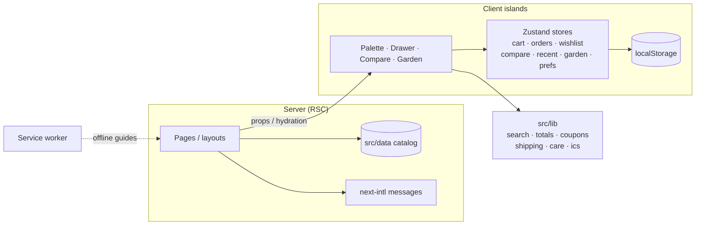
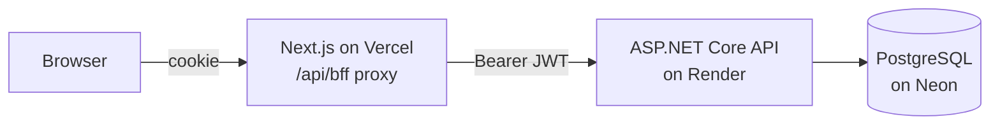

# Brikkhorongon (বৃক্ষরঙ্গন)

A plant and bonsai shop built as a portfolio-grade Next.js app: bilingual (English / বাংলা), accessible, installable, and animated with care.

**Live:** https://brikkhorongon-plant-shop.vercel.app


| Shop | Plant finder | Command palette |
| --- | --- | --- |
|  |  |  |

| Bangla | Dark mode | Mobile |
| --- | --- | --- |
|  |  |  |

> Screenshots are generated by `yarn screenshots` (see [Scripts](#scripts)).

**Stack:** Next.js 16 (App Router) · React 19 · TypeScript · Tailwind CSS v4 · next-intl · Zustand · TanStack Query · React Hook Form + Zod · Vitest · Playwright · ASP.NET Core (.NET 10) · EF Core · PostgreSQL · xUnit · GitHub Actions · Vercel · Render · Neon

The original 2021 Create React App version is kept in [`legacy/`](legacy).

## Features

**Shopping**
- Shop with URL-driven filters; product pages with care info, JSON-LD and per-page metadata
- Bonsai collection with style and indoor/outdoor filters
- **Cmd/Ctrl+K command palette**: ranked plant search, page jump, theme and language switch, order lookup by id
- **Cart drawer** with free-delivery progress, **wishlist**, and **compare up to 3 plants** side by side
- **Coupon codes** and **delivery fee by district / Dhaka area** (one tested `computeTotals` function)
- **Recently viewed** and **"Picked for you"** based on plant-finder answers
- Validated checkout with delivery scheduling and a growing-plant confirmation animation

**After the order**
- Order tracking with a status timeline, an animated delivery scene, and change requests
- **My Garden**: delivered plants with next watering dates and a "watered today" action
- **Care reminders**: download a calendar (`.ics`) with repeating watering events

**Platform**
- English and Bangla, light/dark theme, keyboard friendly, focus-trapped dialogs, skip link, `prefers-reduced-motion` respected
- **PWA**: web manifest, install button, service worker with offline care guides
- `sitemap.xml`, `robots.txt`, security headers

## Architecture



- Pages are **server components** that render catalog data; interactive parts are small client components.
- **State is local-first.** Stores persist to `localStorage`; client-only UI waits for `useMounted()` to avoid hydration mismatches.
- **Business rules are pure functions** in `src/lib` (search ranking, totals, coupons, shipping, watering schedule, iCalendar builder) with unit tests.

## Backend (ASP.NET Core + PostgreSQL)

The live site talks to a real API. The storefront never calls the API from the browser: it calls its own `/api/bff/*` routes, which forward to the .NET API and keep the sign-in token in an httpOnly cookie, so JavaScript can never read it.



- **Accounts:** ASP.NET Identity (hashed passwords, lockout after 5 wrong tries), roles `Admin` (owner) / `Manager` / `Viewer` / `Delivery` / `Customer`, JWT sign-in.
- **Orders:** the server prices every order itself (catalog, coupons, shipping); a tampered price from the browser is ignored. Guests track orders by a long random number.
- **Admin panel** (`/admin`, its own sidebar layout, English-only by design): dashboard and analytics (7/30/90-day revenue, average order value, new vs returning customers, sales by category, low stock); products (add / edit / hide / delete, photo upload, Bangla + English text, stock counts, bulk price/stock edit, CSV import/export); orders (filters, detail page with customer history, internal notes, cancel with restock, refund record, printable invoice and packing slip, CSV export); a daily delivery list by time slot; customers (history, lock/unlock); database-backed coupons (expiry, usage limit, minimum spend); settings (shipping fees, free-shipping line, delivery slots, shop info); review moderation; staff roles; a full audit log and password change. Every permission is enforced on the server (see `Auth/Policies.cs`); the UI only hides buttons.
- **Live catalog:** with the server on, the storefront loads plants, coupons and delivery rules from `GET /api/catalog` (cached 60 s, and cleared the moment the shop team saves). If the API is unreachable it falls back to the built-in catalog. Orders decrease stock inside a database transaction, so the last plant can't be sold twice.
- **Reviews:** signed-in customers only, one per plant, with a "Verified purchase" badge when the author has a delivered order of that plant.
- **Safety:** per-IP rate limits, same-origin check on the proxy, ProblemDetails errors, secrets only in environment variables.
- **Tests:** xUnit covers pricing, order ids and connection strings (`dotnet test backend/BrikkhoRongon.Api.Tests`).
- **Deploy:** `render.yaml` + `backend/Dockerfile` for Render, Neon for the database. The API runs migrations and seeds the 41-plant catalog on start. See [`backend/README.md`](backend/README.md) for local setup.
- Without `NEXT_PUBLIC_USE_API=true` the storefront falls back to the original browser-only demo, which is what keeps the code easy to try without a server.

## Why these decisions

- **App Router + server components**: catalog pages are static and fast; only interactive islands ship JavaScript.
- **Zustand over Redux**: the state is small and flat (lines, orders, ids). `persist` gives local storage in a few lines, selectors avoid re-renders, and there is no boilerplate. Redux would add ceremony without solving a problem here.
- **next-intl with `as-needed` prefixes**: English at `/`, Bangla at `/bn`, typed messages, locale-aware navigation helpers. Detection is off on purpose so the site always opens in English.
- **Tailwind v4 tokens**: colours are CSS variables, so light, dark and component styles stay consistent.
- **Hand-built accessible primitives** (modal with focus trap and scroll lock, combobox palette) instead of a UI kit, to keep the bundle small and the behaviour explicit.
- **Pure `computeTotals`**: cart, checkout and tests share one source of truth for money.

## Getting started

```bash
yarn install
yarn dev        # http://localhost:3000  (Bangla at /bn)
```

## Scripts

| Command | What it does |
| --- | --- |
| `yarn dev` | Start the dev server |
| `yarn build` / `yarn start` | Production build and server |
| `yarn lint` | ESLint |
| `yarn typecheck` | TypeScript, no emit |
| `yarn test` | Unit tests (Vitest) |
| `yarn test:e2e` | End-to-end tests (Playwright). First run: `yarn playwright install chromium` |
| `yarn screenshots` | Regenerate `docs/screenshots/*` (server must be running; `BASE_URL` to target another site) |

## Configuration

| Variable | Purpose |
| --- | --- |
| `NEXT_PUBLIC_SITE_URL` | Public site URL used in sitemap, canonical data and JSON-LD (defaults to `http://localhost:3000`) |
| `NEXT_PUBLIC_USE_API` | `true` to use the server API; unset keeps the browser-only demo |
| `API_URL` | Where the Next.js proxy finds the .NET API (for example `http://localhost:5080`) |

API settings (`ConnectionStrings__Default`, `Jwt__Key`, `Admin__Email`, `Admin__Password`, `Cors__Origins__0`, `ForwardedHeaders__*`) are set as environment variables on the host or with `dotnet user-secrets` locally. Never commit them.

## Honest notes

- Staff sign-ins use JWTs that carry the role, so a role change or an account lock takes effect at the person's next sign-in (tokens last a short while). Uploaded photos are stored in PostgreSQL (the free host's disk is wiped on every deploy); that is fine for a small shop, a bigger one would use object storage. Coupon codes are visible to anyone who inspects the catalog, so they suit public campaigns, not private one-off codes.

- **Server-backed today:** accounts, catalog, orders, stock, coupons, settings, the admin panel and reviews. **Still in the browser:** cart, wishlist and My Garden. Without the API the order-tracking demo panel stands in for the shop team.
- **Free hosting means cold starts:** the Render free plan sleeps after about 15 minutes idle, so the first request can take 30 to 50 seconds.
- **Not built yet:** online payments and order emails (checkout supports cash on delivery in practice), refresh tokens (sign-in lasts 60 minutes).
- **Placeholders to confirm before launch:** delivery fees and free-shipping threshold (`src/lib/shipping.ts`), demo coupon codes (`src/lib/coupons.ts`: `WELCOME10`, `PLANT100`, `FREESHIP`), the 24-hour arrival guarantee copy, and the sample bonsai names, ages and prices.
- Product text is English-only for now. Bonsai photos load from Unsplash (see `next.config.ts`).
- The service worker is registered in production builds only.

## CI

GitHub Actions (`.github/workflows/ci.yml`) runs lint, typecheck, unit tests and a production build, builds and tests the .NET API, then runs the Playwright smoke tests.
